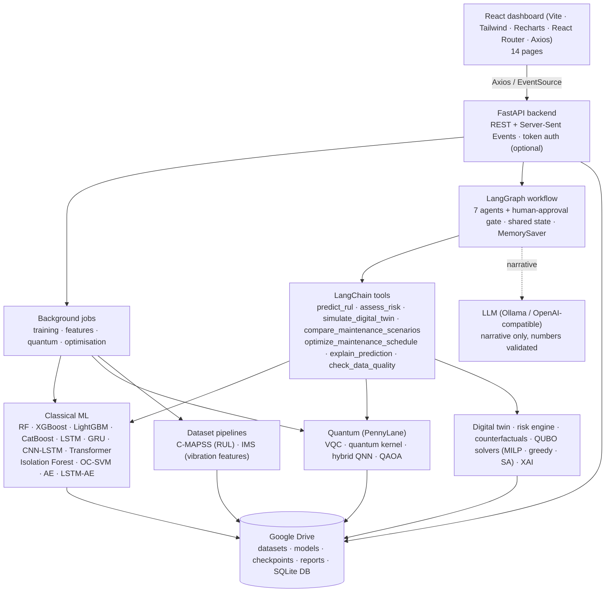

# System architecture



## LangGraph workflow

Generated from the compiled graph (`documentation/agent_graph.mmd`):


| Agent | Tools | Output (shared state) | On error |
|---|---|---|---|
| Data Monitoring | `check_data_quality` | `monitoring`, `valid_assets` | fatal → run ends `failed` |
| Predictive Maintenance | `predict_rul` | `predictions` | per asset; fatal if all fail |
| Risk Assessment | `assess_risk` | `risk`, routing | per asset |
| Digital Twin | `simulate_digital_twin` | `twin` (simulated) | non-fatal |
| Counterfactual Reasoning | `compare_maintenance_scenarios` | `counterfactual`, routing | non-fatal |
| Quantum Optimization | `optimize_maintenance_schedule` | `optimization` | non-fatal |
| Decision Coordination | LLM (narrative) | `decision` | non-fatal; deterministic narrative |
| Human Approval | — (`interrupt`) | `approval`, work orders | run stays paused |

## Data flow and storage

```
Google Drive  /content/drive/MyDrive/Quantum_Agentic_Digital_Twin/
├── datasets/raw|processed|features|dataset_reports      ← backend/storage/datasets.py, backend/datasets/*
├── models/classical_ai|quantum_ai|agentic_ai            ← model.pt + model_info.json, checkpoints/, agent run traces
├── digital_twin/simulation_results|equipment_states
├── experiments/training_logs|evaluation_metrics|comparison_reports, qadt.db (SQLite)
├── optimization/qaoa_results|maintenance_schedules
├── explainability/shap|counterfactuals
├── visualizations/  reports/  configuration/app_settings.json
```

All writes are atomic (temp file + `os.replace`); every storage call goes through `require_drive()`, which
raises with mounting instructions instead of falling back to local disk. `/content/qadt_scratch` is used only
for temporary serialisation.

## Code layout

| Path | Contents |
|---|---|
| `backend/main.py` | FastAPI app, middleware (token auth, access log), static dashboard |
| `backend/api/` | Routers: system, datasets, training, assets (prediction/twin/counterfactual/XAI), optimisation, agents, qseq (quantum sequence models + missing-data agents) |
| `backend/agents/` | `state.py`, `graph.py`, `nodes/`, `runner.py` (background execution, approval), `llm.py`, `chat.py`; `missing_data/` (single agent: data quality → plan → impute → check (retry loop) → forecast → report) |
| `backend/langchain_tools/` | LangChain `StructuredTool`s over the real computations |
| `backend/datasets/` | C-MAPSS and IMS pipelines (separate) |
| `backend/classical_models/` | RUL models, anomaly detectors, metrics, PyTorch networks |
| `backend/quantum_models/` | PennyLane experiments (`qml.py`); Quantum LSTM / Transformer / CNN-LSTM and classical twins (`qseq.py`, `seq_experiments.py`); Qiskit execution and verification (`qiskit_backend.py`) |
| `backend/missing_data/` | Missingness masks (MCAR, block outages), profiling, baseline imputers |
| `backend/workflows.py` | One function per pipeline stage, called by the scripts |
| `backend/risk/`, `digital_twin/`, `counterfactual/`, `optimization/`, `explainability/` | Domain engines |
| `backend/services/fleet.py` | Asset IDs → data, models, predictions, twins (cached) |
| `backend/storage/` | Google Drive layer (mount, datasets, checkpoints, artefacts, storage page) |
| `backend/db.py`, `jobs.py`, `events.py`, `settings.py` | Database, background jobs, SSE bus, configurable assumptions |
| `frontend/src/` | `pages/` (15), `layouts/`, `components/`, `hooks/`, `services/api.js` |
| `scripts/` | Python entry points for every stage (`setup_environment.py` … `run_pipeline.py`, `run_backend.py`); see INSTALLATION_AND_EXECUTION.md. No notebooks. |

## Module layout vs. the requested structure

The requested layout (`backend/data/`, `classical_ai/`, `quantum_ai/`, `*_routes.py`, one file per agent…) is met
by responsibility; file names differ where the existing modules already separate the same concerns and renaming
would break saved-model pickles in Drive and every import:

| Requested | Implemented as |
|---|---|
| `backend/data/` (drive manager, downloader, validator, loaders, preprocessing, features, EDA) | `backend/storage/` (Drive, download, verify, checkpoints, artefacts) + `backend/datasets/cmapss.py`, `ims.py` (load, preprocess, features, EDA) + `backend/missing_data/` |
| `backend/classical_ai/` | `backend/classical_models/` (`rul.py`, `anomaly.py`, `nets.py`, `metrics.py`) |
| `backend/quantum_ai/` | `backend/quantum_models/` (`qml.py` VQC/kernel/QNN, `qseq.py` + `seq_experiments.py`, `qiskit_backend.py`) |
| `backend/api/*_routes.py` | `backend/api/` (`datasets.py`, `training.py`, `assets.py`, `optimization.py`, `agents.py`, `qseq.py`, `system.py`) |
| `backend/agents/*_agent.py`, `workflow.py` | `backend/agents/nodes/*.py` (one file per agent), `graph.py`, `runner.py`; `agents/missing_data/` |
| `backend/langchain_tools/*_tools.py` | `backend/langchain_tools/tools.py`, `agents/missing_data/tools.py` |
| `backend/storage/database.py`, `model_registry.py`, `checkpoint_manager.py` | `backend/db.py`, `storage/artifacts.py`, `storage/checkpoints.py` |
| `scripts/*.py` | identical names, plus `run_pipeline.py` (single entry point), `run_backend.py`, `run_quantum_seq.py` |

## Security controls

| Area | Control | Where | Test |
|---|---|---|---|
| Static files | Only files inside `frontend/dist` are served; `../` in any encoding falls back to `index.html`; unknown `/api/*` → 404 | `backend/main.py` | `test_security.py::test_static_route_*` |
| Result files | `/api/files/{area}/{name}` resolves inside the result area, image/HTML suffixes only | `backend/api/assets.py` | `test_result_file_endpoint_is_confined` |
| Authentication | `QADT_API_TOKEN` (generated by `run_backend.py --tunnel`) required on every `/api` call except `/api/health`; constant-time byte comparison | `backend/main.py` | `test_token_required_when_configured` |
| Token hygiene | `Referrer-Policy: no-referrer`; the dashboard removes `?token=` from the address bar after storing it | `main.py`, `services/api.js` | `test_security_headers_and_cors` |
| Docs exposure | `/docs`, `/redoc`, `/openapi.json` disabled when a token is set | `backend/main.py` | `test_docs_and_schema_hidden_when_token_set` |
| CORS | Allow-list from `QADT_CORS_ORIGINS` (default: local dev origins); the dashboard is same-origin | `backend/main.py` | `test_security_headers_and_cors` |
| Headers | `X-Content-Type-Options: nosniff`, `X-Frame-Options: DENY` | `backend/main.py` | same |
| Settings | Unknown keys, wrong types, out-of-range values rejected (e.g. `max_qubits` ≤ 20, Monte-Carlo samples ≤ 200k, `llm.base_url` http(s) only, ordered risk thresholds) | `backend/settings.py` | `test_settings_reject_*` |
| Dataset upload | ≤ `QADT_MAX_UPLOAD_BYTES` (2 GiB), valid ZIP, SHA-256 must equal the official NASA archive unless `allow_unofficial=true`; previous archive kept | `backend/api/datasets.py` | `test_dataset_upload_limits_*` |
| Archive extraction | Members confined to the destination (zip-slip), total size ≤ `QADT_MAX_EXTRACT_BYTES` (20 GiB) | `backend/storage/datasets.py` | `test_zip_slip_is_rejected`, `test_zip_bomb_guard` |
| Agent requests | Asset id pattern, missing rate in [0, 1), uploaded windows ≤ 500 × 64 | `backend/api/qseq.py` | `test_agent_request_limits` |
| Error messages | Absolute storage paths replaced by `<project>` / `<scratch>` / `<drive>` | `backend/api/common.py` | `test_error_messages_do_not_leak_storage_paths` |
| Secrets | LLM keys only from the environment (never stored in settings or returned by the API); Drive credentials are handled by Google's mount, never by this code | `backend/agents/llm.py` | — |

Residual risks: the public tunnel URL plus token is a bearer secret (anyone holding the link has full access); no
rate limiting; the optional Ollama installer in `run_backend.py --ollama-model` runs the vendor's shell script.
