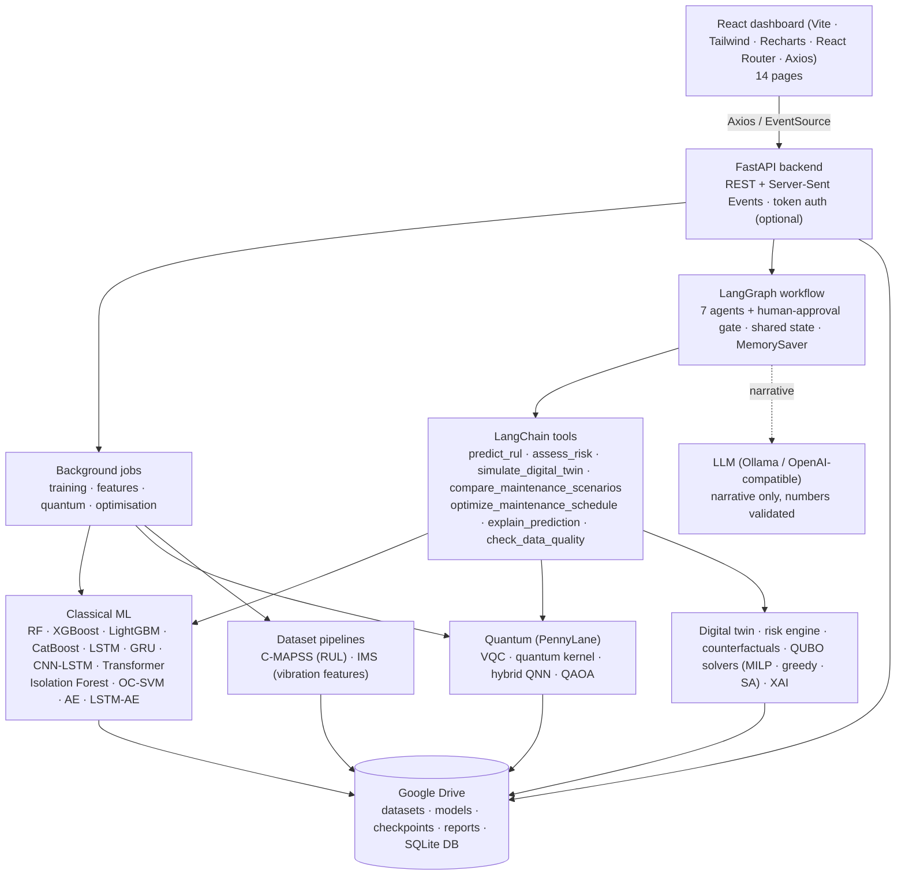
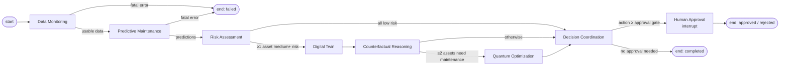

# System architecture



## LangGraph workflow

Generated from the compiled graph (`documentation/agent_graph.mmd`):



| Agent | Tools | Output (shared state) | On error |
|---|---|---|---|
| Data Monitoring | `check_data_quality` | `monitoring`, `valid_assets` | fatal → run ends `failed` |
| Predictive Maintenance | `predict_rul` | `predictions` | per asset; fatal if all fail |
| Risk Assessment | `assess_risk` | `risk`, routing | per asset |
| Digital Twin | `simulate_digital_twin` | `twin` (simulated) | non-fatal |
| Counterfactual Reasoning | `compare_maintenance_scenarios` | `counterfactual`, routing | non-fatal |
| Quantum Optimization | `optimize_maintenance_schedule` | `optimization` | non-fatal |
| Decision Coordination | LLM (narrative) | `decision` | non-fatal; deterministic narrative |
| Human Approval | — (`interrupt`) | `approval`, work orders | run stays paused |

## Data flow and storage

```
Google Drive  /content/drive/MyDrive/Quantum_Agentic_Digital_Twin/
├── datasets/raw|processed|features|dataset_reports      ← backend/storage/datasets.py, backend/datasets/*
├── models/classical_ai|quantum_ai|agentic_ai            ← model.pt + model_info.json, checkpoints/, agent run traces
├── digital_twin/simulation_results|equipment_states
├── experiments/training_logs|evaluation_metrics|comparison_reports, qadt.db (SQLite)
├── optimization/qaoa_results|maintenance_schedules
├── explainability/shap|counterfactuals
├── visualizations/  reports/  configuration/app_settings.json
```

All writes are atomic (temp file + `os.replace`); every storage call goes through `require_drive()`, which
raises with mounting instructions instead of falling back to local disk. `/content/qadt_scratch` is used only
for temporary serialisation.

## Code layout

| Path | Contents |
|---|---|
| `backend/main.py` | FastAPI app, middleware (token auth, access log), static dashboard |
| `backend/api/` | Routers: system, datasets, training, assets (prediction/twin/counterfactual/XAI), optimisation, agents |
| `backend/agents/` | `state.py`, `graph.py`, `nodes/`, `runner.py` (background execution, approval), `llm.py`, `chat.py` |
| `backend/langchain_tools/` | LangChain `StructuredTool`s over the real computations |
| `backend/datasets/` | C-MAPSS and IMS pipelines (separate) |
| `backend/classical_models/` | RUL models, anomaly detectors, metrics, PyTorch networks |
| `backend/quantum_models/` | PennyLane experiments |
| `backend/risk/`, `digital_twin/`, `counterfactual/`, `optimization/`, `explainability/` | Domain engines |
| `backend/services/fleet.py` | Asset IDs → data, models, predictions, twins (cached) |
| `backend/storage/` | Google Drive layer (mount, datasets, checkpoints, artefacts, storage page) |
| `backend/db.py`, `jobs.py`, `events.py`, `settings.py` | Database, background jobs, SSE bus, configurable assumptions |
| `frontend/src/` | `pages/` (14), `layouts/`, `components/`, `hooks/`, `services/api.js` |
| `notebooks/` | Colab: storage setup, run the app with a tunnel, train & evaluate everything |
| `scripts/` | Batch training, docs generation, Colab bundle, macOS OpenMP fix |
